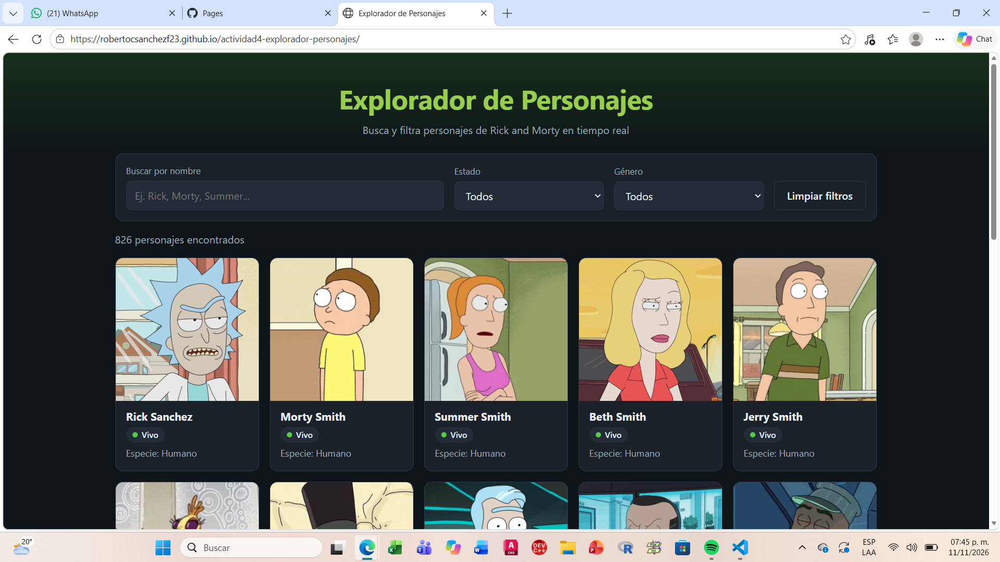
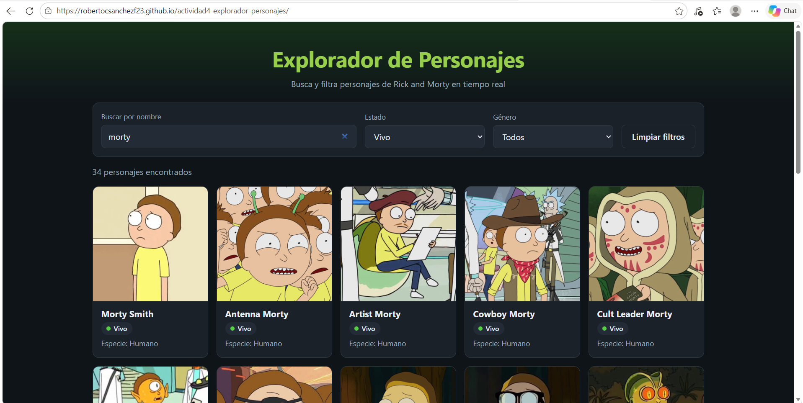
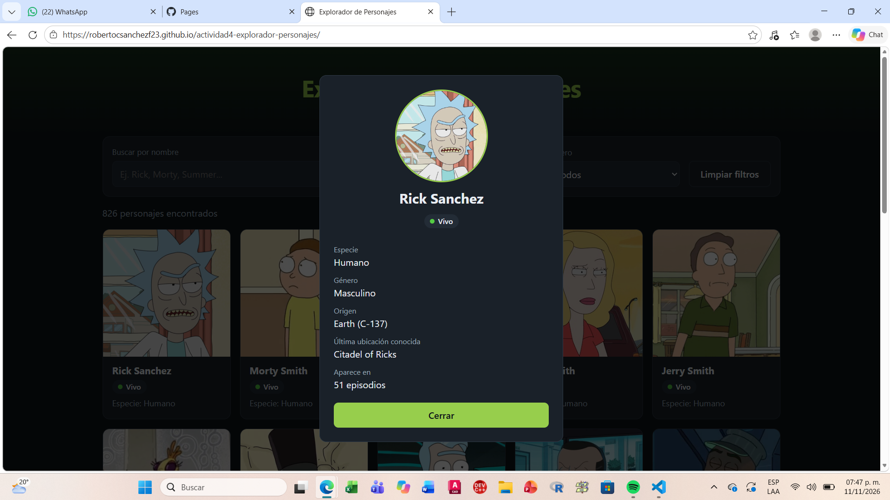
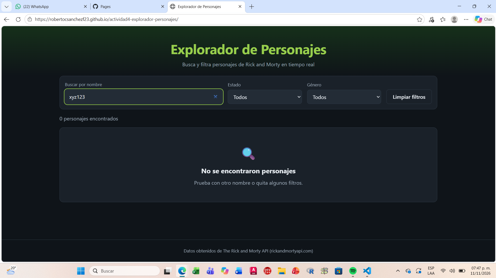
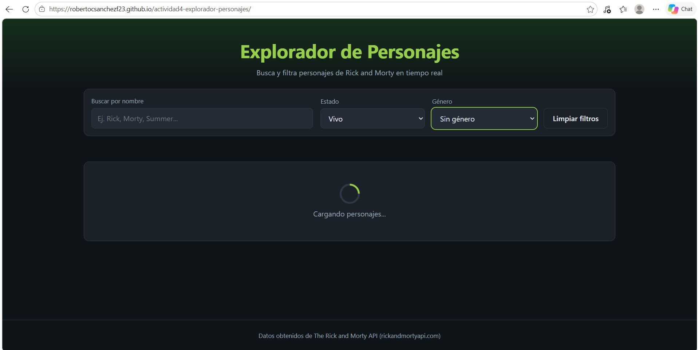
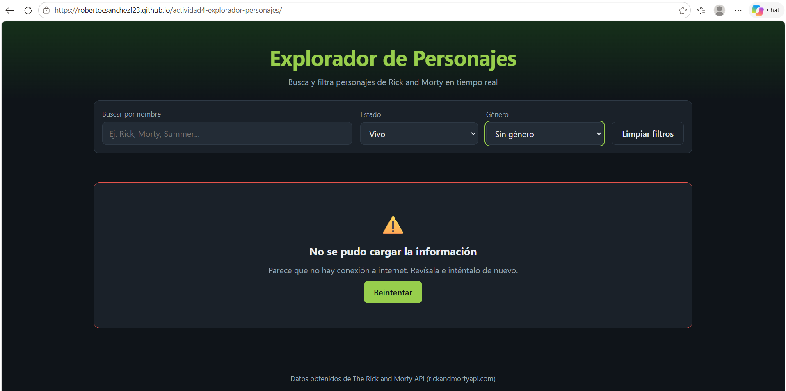
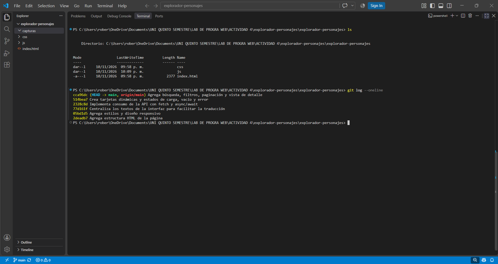

# Explorador de Personajes

**Actividad 4. Miniaplicación web consumiendo una API REST**
Laboratorio de Programación Web · FIME, UANL · Grupo 406
Profesora: Laura Patricia del Bosque Vega

**Integrantes**

| Nombre | Matrícula |
|---|---|
| Edmundo Santos Ramírez | 2148132 |
| Angela Susana Torres Pasillas | 2101844 |
| Edgar Jesus Del Angel Martinez | 2160745 |
| Roberto Carlos Sánchez Flores | 2151262 |
| Aaron Sebastian Torres Cabriales | 2153261 |

🔗 **Aplicación publicada:** https://robertocsanchezf23.github.io/actividad4-explorador-personajes/
📁 **Repositorio:** https://github.com/RobertocSanchezf23/actividad4-explorador-personajes

---

## Descripción

Miniaplicación web que obtiene en tiempo real la información de los personajes de la serie *Rick and Morty* desde un servicio externo, sin capturar ningún dato manualmente. El usuario puede buscar personajes por nombre, filtrarlos por estado y género, recorrer los resultados por páginas y abrir una ficha de detalle de cada personaje.

La aplicación está hecha con HTML5, CSS3 y JavaScript (ES6+) sin librerías ni frameworks. Toda la comunicación con el servidor se hace con **Fetch API** y **async/await**, y los resultados se muestran con componentes creados dinámicamente en el DOM.

## API utilizada

**The Rick and Morty API**: https://rickandmortyapi.com/documentation

- API REST pública y gratuita.
- **No requiere registro ni API key**, por lo que no se maneja ningún dato sensible.
- Responde en formato **JSON** y permite peticiones desde el navegador (CORS habilitado).
- Contiene más de 800 personajes con nombre, estado, especie, género, origen, ubicación, imagen y episodios.

## Endpoint utilizado

```
GET https://rickandmortyapi.com/api/character/
```

**Parámetros que usa la aplicación** (se envían en la URL como *query string*):

| Parámetro | Descripción | Valores |
|---|---|---|
| `page` | Número de página (20 personajes por página) | 1, 2, 3... |
| `name` | Filtra por nombre (coincidencia parcial) | texto libre, ej. `morty` |
| `status` | Filtra por estado | `alive`, `dead`, `unknown` |
| `gender` | Filtra por género | `female`, `male`, `genderless`, `unknown` |

Ejemplo de petición:

```
https://rickandmortyapi.com/api/character/?page=1&name=rick&status=alive
```

**Formato de respuesta (JSON):**

```json
{
  "info": {
    "count": 826,
    "pages": 42,
    "next": "https://rickandmortyapi.com/api/character/?page=2",
    "prev": null
  },
  "results": [
    {
      "id": 1,
      "name": "Rick Sanchez",
      "status": "Alive",
      "species": "Human",
      "gender": "Male",
      "origin": { "name": "Earth (C-137)" },
      "location": { "name": "Citadel of Ricks" },
      "image": "https://rickandmortyapi.com/api/character/avatar/1.jpeg",
      "episode": ["https://rickandmortyapi.com/api/episode/1", "..."]
    }
  ]
}
```

**Códigos de respuesta y cómo los maneja la aplicación:**

| Situación | Código | Qué muestra la aplicación |
|---|---|---|
| Petición correcta | `200 OK` | Las tarjetas de personajes y la paginación |
| Ningún personaje coincide con la búsqueda | `404 Not Found` | Mensaje de "No se encontraron personajes" (resultado vacío) |
| Error del servidor u otro código | `500`, etc. | Mensaje de error con el código y botón "Reintentar" |
| Sin conexión a internet | (sin respuesta) | Mensaje de error de conexión y botón "Reintentar" |

## Funcionalidades

- **Consumo de la API** con `fetch()` y `async/await`.
- **Búsqueda por nombre** mientras se escribe, esperando 400 ms después de la última tecla para no hacer una petición por cada letra.
- **Filtros** por estado y género, combinables con la búsqueda.
- **Paginación** con botones Anterior / Siguiente.
- **Ficha de detalle** al hacer clic en una tarjeta (especie, género, origen, última ubicación y número de episodios).
- **Estados de la interfaz:** carga, resultado vacío y error con mensajes comprensibles.
- **Cancelación de peticiones anteriores** con `AbortController`, para que una respuesta lenta no reemplace a una búsqueda más reciente.
- **Diseño responsivo**, adaptado a computadora y celular.

## Instrucciones de uso

**En línea:** abrir https://robertocsanchezf23.github.io/actividad4-explorador-personajes/

1. Al abrir la página se cargan los primeros 20 personajes.
2. Escribir un nombre en **"Buscar por nombre"** (por ejemplo, *Morty*) para filtrar los resultados.
3. Usar los menús **Estado** y **Género** para acotar la búsqueda.
4. Usar **Anterior** y **Siguiente** para cambiar de página.
5. Hacer clic en una tarjeta para ver la **ficha de detalle**; cerrarla con el botón **Cerrar** o haciendo clic fuera de ella.
6. **Limpiar filtros** regresa la lista a su estado inicial.

**En local:**

```bash
git clone https://github.com/RobertocSanchezf23/actividad4-explorador-personajes.git
```

Después abrir `index.html` en el navegador. Se necesita conexión a internet, porque los datos se obtienen de la API.

## Estructura del proyecto

```
├── index.html        Estructura de la página
├── css/
│   └── styles.css    Estilos y diseño responsivo
├── js/
│   ├── textos.js     Textos de la interfaz (facilita la traducción)
│   ├── api.js        Consumo de la API con fetch y async/await
│   ├── ui.js         Creación de componentes en el DOM y estados de la interfaz
│   └── app.js        Eventos: búsqueda, filtros, paginación y detalle
└── capturas/         Capturas de pantalla para este README
```

## Capturas


*Figura 1. Pantalla principal de la aplicación con los primeros 20 personajes obtenidos de la API.*


*Figura 2. Búsqueda por nombre ("morty") combinada con el filtro de estado "Vivo".*


*Figura 3. Ficha de detalle que se abre al seleccionar un personaje.*


*Figura 4. Mensaje de resultado vacío cuando ningún personaje coincide con la búsqueda (respuesta 404 de la API).*


*Figura 5. Estado de carga mientras se espera la respuesta de la API (conexión lenta simulada con DevTools).*


*Figura 6. Mensaje de error y botón "Reintentar" ante la falta de conexión (simulada con DevTools).*


*Figura 7. Historial de commits del proyecto en Git.*

## Reflexión técnica

Esta actividad nos permitió ver la diferencia entre una página con datos fijos y una aplicación que obtiene la información de un servicio externo. Al trabajar con `fetch()` y `async/await` entendimos que una petición a una API no responde de inmediato, y que la interfaz debe informar al usuario lo que está pasando en cada momento: mientras carga, cuando no hay resultados y cuando algo falla.

Un aprendizaje importante fue que no todos los códigos de error significan lo mismo. Esta API responde **404** cuando ningún personaje coincide con la búsqueda; si no lo hubiéramos revisado en la documentación, la aplicación habría mostrado un error cuando en realidad se trataba de un resultado vacío. También notamos que, si el usuario escribe rápido, pueden llegar respuestas en desorden, y lo resolvimos esperando a que termine de escribir y cancelando la petición anterior con `AbortController`.

Separar el código en archivos con una responsabilidad cada uno (textos, API, interfaz y eventos) hizo más fácil organizar los commits y encontrar errores. Por último, publicar el proyecto en GitHub Pages nos mostró lo sencillo que es poner una aplicación en línea y compartirla mediante una URL pública.

## Tecnologías

HTML5 · CSS3 · JavaScript ES6+ · Fetch API · JSON · Git · GitHub · GitHub Pages

---

Datos proporcionados por [The Rick and Morty API](https://rickandmortyapi.com). 
